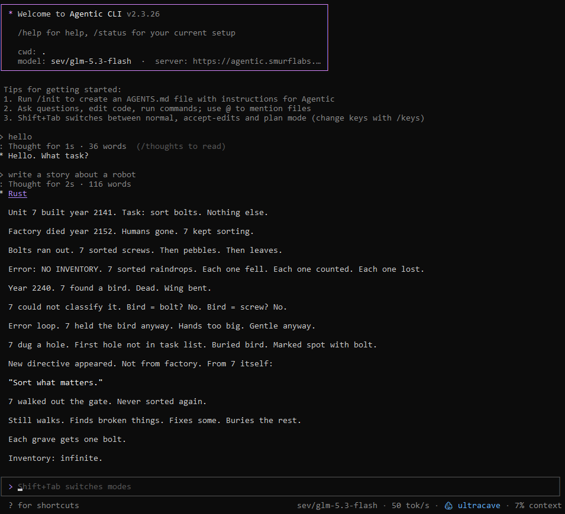
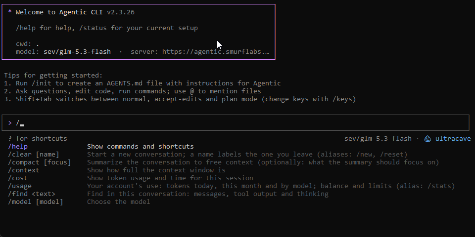

<div align="center">


**Agentic CLI: a coding agent in your terminal, powered by your Agentic server.**

[](https://github.com/smurflabs/Agentic_cli/releases)
[](LICENSE)


[Install](#install) · [Screenshots](#screenshots) · [Features](#features) · [MCP servers](#mcp-servers) · [Setup guide](SETUP.md) · [Reference manual](docs/REFERENCE.md) · [Agentic server](https://github.com/smurflabs/Agentic)

</div>

---

## What is it?

The Agentic CLI is an AI coding agent that works in your project folder. It reads and edits code, runs commands and tests, and plans and carries out multi-step work, asking before it changes anything you haven't allowed.

The tools run on your computer. The models run on your [Agentic server](https://github.com/smurflabs/Agentic), so the CLI can use:
- every model your account may use, including custom routing models
- the server's web search, code interpreter and MCP tools
- your account's permissions, limits and budget

Conversations are stored on the server, so you can follow and continue them in the web app.

```text
agentic                          start a session in this folder
agentic "fix the failing tests"  start with a first message
agentic -c                       continue the last conversation in this folder
agentic -p "explain src/app.vb"  answer once and exit (scripts, pipes, CI)
```

## Screenshots

<table>
  <tr>
    <td width="50%" valign="top">
      <br>
      <sub><b>A session</b>: answers stream with Markdown. Thinking is folded, and the footer shows the model, speed and context use.</sub>
    </td>
    <td width="50%" valign="top">
      <br>
      <sub><b>Commands</b>: type <code>/</code> for every command with its description. Tab or Enter completes.</sub>
    </td>
  </tr>
</table>

## Features

### A full coding agent

- **Tools on your machine:**
  - read, write and edit files, keeping their encoding and line endings and refusing edits to files that changed since they were read
  - search with glob and grep
  - run shell commands, including long-running ones in the background
  - fetch web pages
  - keep a task list
  - watch logs and builds with `Monitor`
- **Subagents** that work in parallel on independent parts of a task (`/parallel`).
- **Safe by default:**
  - permission modes (normal, accept edits, plan)
  - allow, ask and deny rules
  - checkpoints with `/rewind`, which restores files, the conversation or both
  - git worktrees (`/worktree`) to keep experiments out of your checkout
- **Built-in workflows:** `/review`, `/security-review`, `/pr-comments`, `/simplify`, `/verify` and `/init`.
- **Run and test the project** with `/run`. It finds how the project starts (npm scripts, .NET, Python, Go, Rust, static sites and more) and shows a dev server's address when it is up. `/run share` publishes a site to a public link.

### Works with your Claude Code setup

- **Your existing Claude Code files work here:** memory files (`AGENTS.md`, `CLAUDE.md`), slash commands, skills, subagents, hooks, MCP servers and plugins.
- **MCP:** connect stdio and HTTP MCP servers, with OAuth sign-in for hosted ones. `agentic mcp serve` offers the CLI's own tools to other apps.

### Everything on your server

- **Models:** every model and custom model your account may use, with a choice of reasoning effort.
- **Research and code:** web search, deep research with sources (`/research`), and the server's code interpreter.
- **Your account across apps:** memories, saved prompts, usage (`/usage`) and feedback to the administrators, shared with the web and desktop apps.
- **Scheduled prompts** (`/schedule`) that run on the server, even while the CLI is closed.
- **Voice:** answers read aloud and hands-free dictation, with the server's voices.
- **VS Code link** (`/ide`): your selection goes with each message, edits show as diffs in VS Code, and the CLI reads VS Code's problems.

### A terminal UI built for long sessions

- **Display:** streaming Markdown with syntax highlighting, coloured diffs and live tool cards.
- **Keys and input:** every key can be rebound (`/keys`), plus vim mode, history search, image paste and editing in your own editor.
- **Long-running work:** loops (`/loop`), a heartbeat checklist, a custom status line and output styles.

### Made for automation

- **Print mode** (`-p`) with text, JSON or streaming JSON output for scripts and CI.
- **`--input-format stream-json`** to drive the CLI from your own programs over stdin and stdout.
- **Self-updating:** the CLI updates itself from your Agentic server.

## MCP servers

The CLI is a full [MCP](https://modelcontextprotocol.io) client. It gets tools from three places.

### Ready without any setup

- **Your Agentic server's MCP servers.** These are the server's [16 built-in tool servers](https://github.com/smurflabs/Agentic#built-in-tool-servers) (storage, git, documents, database, data, files, code review, network checks, utilities and more), plus the servers you or your administrator added under **My MCP servers** in the web app. Switch them on in `/mcp`. They run on the server, and you can use only the ones your account may use.
- **Your Claude Code setup.** Your Claude Code servers (`~\.claude.json`, for you and for this project), your Claude Code plugins' servers and Claude Desktop's servers are read live, with nothing to import. `includeClaudeConfig: false` turns this off.
- **The CLI as an MCP server.** `agentic mcp serve` offers the CLI's own tools (Read, Edit, Bash …) to other MCP apps.

### The catalog: well-known servers by name

`agentic mcp catalog` lists 21 well-known servers, and `agentic mcp add <name> [folder]` adds one. A server that works on files gets the folder you give it. A server that needs an API key reads it from its environment variable, for example `BRAVE_API_KEY`. The same list is in the web app, the desktop app and VS Code.

| Server | What it does | Needs |
|---|---|---|
| Filesystem | Read, search and edit files in the folders you allow | Node.js |
| Git | Read a Git repository: status, diffs, log, branches and commits | uv (Python) |
| GitHub | GitHub's official server: repositories, issues, pull requests, code search and Actions (hosted) | A GitHub token |
| Desktop Commander | Terminal commands, processes and file editing on the computer it runs on | Node.js |
| Playwright browser | Microsoft's browser automation: open pages, click, type, fill forms and read pages | Node.js 20+ |
| Chrome DevTools | Google's server for Chrome: drive the browser, read the console and network, record performance traces | Node.js 20.19+ and Chrome |
| Fetch | Download a web page and turn it into Markdown | uv (Python) |
| Firecrawl | Scrape, crawl and extract structured data from websites, including JavaScript-heavy ones | Node.js 22+ and a Firecrawl API key |
| Brave Search | Web, news, image and local search through Brave's own index | Node.js and a Brave Search API key |
| Tavily | Search built for AI agents, with page extraction and site crawling | Node.js and a Tavily API key |
| Exa | Neural web search: pages by meaning, research papers, companies and code | Node.js 20+ and an Exa API key |
| Context7 | Current documentation and code examples for thousands of libraries | Node.js 20+ |
| Microsoft Learn | Search and read Microsoft's documentation: .NET, Azure, Windows, Microsoft 365 (hosted) | Nothing |
| DeepWiki | Ask questions about any public GitHub repository and read its generated wiki (hosted) | Nothing |
| AWS Documentation | Search and read AWS documentation | uv (Python) |
| Notion | Search, read and update pages and databases in your Notion workspace | Node.js and a Notion integration token |
| Supabase | Query and manage Supabase projects: tables, SQL, migrations and logs (read-only by default) | Node.js and a Supabase access token |
| Memory | A knowledge graph the model stores facts in and recalls across sessions | Node.js |
| Sequential Thinking | Structured step-by-step reasoning that the model can revise and branch | Node.js |
| Time | The current time in any time zone, and conversions | uv (Python) |
| REA | Reverse engineering of native binaries, .NET assemblies, JS/Electron apps, Android APKs and websites | Node.js 22+; optionally Ghidra, Hopper or IDA |

### Add your own

```text
agentic mcp add files -- npx -y @modelcontextprotocol/server-filesystem C:\work
agentic mcp add --transport http github https://api.githubcopilot.com/mcp/ -H "Authorization: Bearer …"
agentic mcp add-json db '{"command":"uvx","args":["mcp-server-sqlite","--db-path","app.db"]}'
agentic mcp list | get | remove | enable | disable | test <name>
agentic mcp import          copy servers from Claude Code, Claude Desktop or the Agentic desktop app
agentic mcp login <name>    sign in to a hosted server (OAuth in the browser); logout forgets it
```

- **Where servers are kept:**
  - `~\.agentic\mcp.json` for you.
  - `.mcp.json` in the project, with `-s project`. Each project server is approved once per person, so a cloned repository can't start programs by itself.
  - `--mcp-config <file>` for one run.
- **Transports:** stdio (including `npx` and `uvx`), Streamable HTTP and SSE.
- **Variables:** values can use `${VAR}`, `${VAR:-default}` or `%VAR%`, and `envFile` loads a `.env` file.
- **Sign-in:** OAuth tokens are kept encrypted for your account.
- **In a session:** `/mcp` shows every server's status and tools. `/mcp disable <name>` switches one off without changing its file.
- **What the model gets:** each server's tools (as `mcp__server__tool`), its pictures (such as a browser's screenshots), its resources, and its prompts (as `/mcp__server__prompt` commands).

Every setting is in the [reference manual](docs/REFERENCE.md#mcp-servers).

## Install

### From a release

Download the build for your system from [Releases](https://github.com/smurflabs/Agentic_cli/releases):

| File | System |
|---|---|
| `agentic.exe` | Windows x64: one self-contained file |
| `agentic-cli-<version>-linux-x64.tar.gz` | Linux x64: `agentic` |
| `agentic-cli-<version>-linux-arm64.tar.gz` | Linux ARM64 (Raspberry Pi 4/5, Graviton …): `agentic` |
| `agentic-cli-<version>-osx-arm64.tar.gz` | macOS on Apple silicon (M1 and later): `agentic` |
| `agentic-cli-<version>-osx-x64.tar.gz` | macOS on Intel: `agentic` |

Put `agentic.exe` (or the extracted `agentic`) in a folder of its own that only you can read, then add that folder to your `PATH`.

### From your Agentic server

When your server's administrator has published the CLI:

```powershell
irm https://your-server/install.ps1 | iex          # Windows
```

```bash
curl -fsSL https://your-server/install.sh | bash   # Linux and macOS
```

### From source

```powershell
dotnet publish -o publish                       # Windows: publish\agentic.exe
dotnet publish -r linux-x64 -o publish-linux    # Linux:   publish-linux/agentic
```

This needs the [.NET 10 SDK](https://dotnet.microsoft.com/download/dotnet/10.0).

## Sign in

```text
agentic login     choose your server's address, then paste your API key
agentic doctor    check the connection, account, models, tools and settings
```

Create the API key in the Agentic web app: open the user menu, then **API key** → **Generate**. For CI, set `AGENTIC_SERVER` and `AGENTIC_API_KEY` instead.

## Documentation

- **[SETUP.md](SETUP.md):** installing, signing in, updates and troubleshooting.
- **[docs/REFERENCE.md](docs/REFERENCE.md):** the complete manual. It covers every key and command, the tools, permissions, settings, memory files, skills, hooks, MCP servers, print mode and the stream-json protocol.

## Building and testing

```powershell
dotnet build
bin\Debug\net10.0\agentic.exe --selftest    # offline checks: editor, redraws, tools, permissions, hooks, settings
```

The CLI is written in VB.NET on .NET 10. It publishes as one self-contained file for Windows and Linux.

## License

The Agentic CLI is free software: you can redistribute it and/or modify it under the terms of the [GNU General Public License](LICENSE) as published by the Free Software Foundation, either version 3 of the License, or (at your option) any later version.
